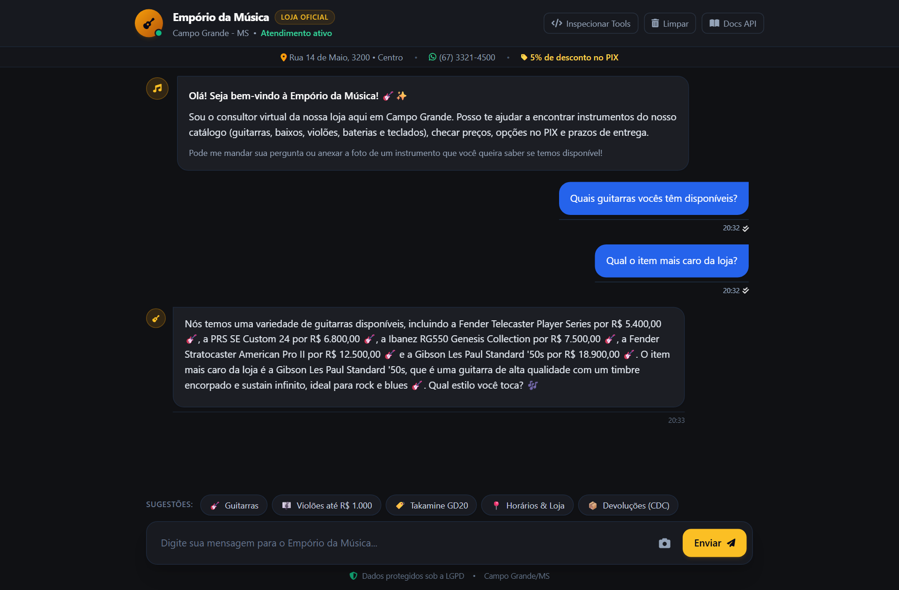

# 🎸 Empório da Música - Autonomous AI Customer Service Agent

[](https://www.python.org/)
[](https://fastapi.tiangolo.com/)
[](https://openrouter.ai/)
[](https://www.docker.com/)
[-10B981?style=for-the-badge)](https://www.planalto.gov.br/ccivil_03/_ato2015-2018/2018/lei/l13709.htm)

> 🌐 **Language / Idioma**: **English** | [Versão em Português](README_PT.md)

Production-ready prototype of an **Autonomous AI Customer Service Agent** for **Empório da Música**, a traditional musical instrument retail store based in Campo Grande/MS (Brazil) since 2008.

The agent automates high-frequency customer support interactions: real-time stock and price inquiries, order status and tracking verification, strict adherence to store policies and consumer rights (CDC, return windows, warranties), message debouncing queues for humanized conversational flow, and out-of-scope intent filtering.

---

## 📑 Table of Contents

- [Overview & Persona](#-overview--persona)
- [System Architecture](#-system-architecture)
  - [Official Agent Tools (Function Calling)](#-official-agent-tools-function-calling)
- [Technical Justifications & Architectural Pillars](#-technical-justifications--architectural-pillars)
- [Resilience, Queue Debouncing & Security Safeguards](#-resilience-queue-debouncing--security-safeguards)
- [Data Privacy & LGPD Compliance (7-Day TTL)](#-data-privacy--lgpd-compliance-7-day-ttl)
- [Getting Started](#-getting-started)
  - [Option 1: Docker Compose (Recommended)](#option-1-docker-compose-recommended)
  - [Option 2: Local Environment](#option-2-local-environment)
  - [Running the Automated Test Suite](#-running-the-automated-test-suite)
- [Web Interface & API Reference](#-web-interface--api-reference)
- [Omnichannel Integration (WhatsApp / Web / Bots)](#-omnichannel-integration-whatsapp--web--bots)
- [Evaluation Scenarios & Interaction Examples](#-evaluation-scenarios--interaction-examples)
- [Known Limitations & Strategic Roadmap](#-known-limitations--strategic-roadmap)
- [AI Code Assistant Usage & Workflow Transparency](#-ai-code-assistant-usage--workflow-transparency)

---

## 🎯 Overview & Persona

Empório da Música values warm, transparent, and technically sound customer advisory:
- **Tone of Voice**: Informal, helpful, and professional — resembling an experienced in-store music specialist.
- **Domain Boundary**: The store exclusively sells **musical instruments** (guitars, basses, drums, keyboards, woodwinds, brass, strings, ukuleles). It **does not sell accessories** (loose strings, picks, cables, pedals, amplifiers, or cases). The agent cordially redirects accessory requests to third-party stores.
- **Commitment to Truth (Zero Hallucination)**: Prices, discounts, inventory levels, and order tracking codes are always fetched from verified relational and document data sources. The agent never invents prices or bank payment keys.

---

## 🏗 System Architecture

The application implements a modular architecture centered around a native **ReAct cycle with deterministic Function Calling**:

```
                              ┌────────────────────────────────────────┐
                              │             Access Channels            │
                              │    Embedded Web Chat | RESTful API     │
                              └───────────────────┬────────────────────┘
                                                  │
                                                  ▼
                              ┌────────────────────────────────────────┐
                              │            FastAPI Server              │
                              │   - Message Debounce Buffer (Queue)    │
                              │   - Text & Multimodal Media Endpoints  │
                              └───────────────────┬────────────────────┘
                                                  │
                                                  ▼
                              ┌────────────────────────────────────────┐
                              │         ReAct Agent Core Engine        │
                              │      OpenRouter (e.g. gpt-4o-mini)     │
                              │   + Automatic Multi-Model Fallbacks    │
                              │   + Prompt Shield & Scope Guardrails   │
                              └───────────────────┬────────────────────┘
                                                  │
                ┌─────────────────────────────────┼────────────────────────────────┐
                ▼                                 ▼                                ▼
     ┌──────────────────────┐          ┌──────────────────────┐         ┌──────────────────────┐
     │   Relational Engine  │          │   Knowledge Engine   │         │    Session Manager   │
     │       (SQLite)       │          │     (Hybrid RAG)     │         │   (Memory & LGPD)    │
     │ - Products & Stock   │          │ - Store PDF Manual   │         │ - 7-Day Memory TTL   │
     │ - Orders & Tracking  │          │ - CDC / Refund Rules │         │ - Human Escalation   │
     │ - Active Promotions  │          │ - Working Hours & MS │         │ - Temporary AI Pause │
     └──────────────────────┘          └──────────────────────┘         └──────────────────────┘
```

### Core Architecture Components
1. **Central Orchestrator**: Async Python implementation of the ReAct cognitive cycle with strict tool calling schemas.
2. **Structured Relational Storage (SQLite)**: Operates over normalized operational data (`products`, `orders`, `order_items`, `promotions`, `customers`, `categories`) loaded into memory-mapped indexed SQLite, preventing numeric hallucinations.
3. **Store Policies Engine (Domain RAG)**: Canonical parsing of `políticas_da_loja.pdf` partitioned into normative sections (CDC 7-day remorse return, 30-day store warranty, 90-day manufacturer guarantee, shipping rules, and working hours).
4. **Intelligent Debounce Queue**: Multiple sentences typed in rapid sequence (2.2s window) are consolidated into a unified prompt, preventing fragmented agent replies.
5. **Human Escalation & AI Pause (`pause_ia`)**: Detects explicit human assistance requests or serious complaints, sets operational handoff flags, pauses the bot for 10 minutes, and provides immediate direct store contact channels (WhatsApp and landline).

---

### 🛠️ Official Agent Tools (Function Calling)

The agent leverages 6 deterministic tools, strictly separating natural language reasoning from factual data retrieval:

| Tool Name | Parameters | Purpose & Business Logic |
|---|---|---|
| `consultar_catalogo` | `termo`, `categoria`, `preco_maximo`, `preco_minimo`, `ordenar_por` (`preco_asc` / `preco_desc`) | Searches active musical instruments in stock with structured filters. Computes 5% cash PIX discount and active stock-clearance sale prices. |
| `consultar_promocoes_ativas` | *(none)* | Instantly retrieves all active promotions and special discount campaigns (e.g., Crafter 18% OFF, Ohana 20% OFF) with calculated final prices. |
| `consultar_detalhes_produto` | `produto_id` (`int`) | Fetches in-depth technical specifications: tonewoods, fretboard, pickups, finish, and raw spec JSON. |
| `consultar_status_pedido` | `id_pedido` (`int`, **required**), `identificador_cliente` (`str`, optional) | **Order Lookup by ID**: Retrieves delivery status, courier tracking code, items, and scheduled delivery date.<br>**LGPD Data Protection**: Requires the formal Order ID. Refuses blind searches solely by customer name or phone to prevent leaking purchase histories to third parties. |
| `consultar_politicas` | `topico` (`str`) | Hybrid RAG over the official store manual (PDF) covering CDC legal remorse return (7 days with free return freight), exchange windows, warranties, and business hours. |
| `solicitar_atendimento_humano` | `motivo`, `resumo` | Triggers human takeover for sensitive complaints or direct requests, temporarily pausing the AI (`is_human_paused = True`) and returning verified human contact channels. |

---

## 💡 Technical Justifications & Architectural Pillars

Below, I outline the technical justifications for each architectural pillar of the project:

| Architectural Pillar | Choice | Summary Rationale |
|---|---|---|
| **1. Framework** | FastAPI (Python 3.12) + Native ReAct | High asynchronous throughput, native OpenAPI documentation, zero bloat/lock-in from heavy wrappers (LangChain/CrewAI), and total lifecycle message control. |
| **2. Agent Paradigm** | ReAct with Strict Function Calling | Strict separation between cognition (LLM) and facts (SQL/Rules). Completely eliminates pricing, inventory, and legal CDC hallucinations. |
| **3. Model & Provider** | OpenRouter (`gpt-4o-mini` + Multi-Fallback) | Unified API across frontier providers (OpenAI, Google, Meta, Anthropic), sub-second latency, low token cost, and resilience against vendor downtime. |
| **4. Hybrid UI** | Embedded Web Chat + RESTful API | Instant browser-based assessment without Node.js dependencies, coupled with plug-and-play REST endpoints for WhatsApp bots (Evolution API, Z-API, n8n). |
| **5. Memory & LGPD** | In-Memory Sessions with 7-Day TTL | Strict compliance with the Brazilian General Data Protection Law (Lei 13.709/2018); automated 7-day conversation purge and right-to-be-forgotten deletion. |
| **6. Data Ingestion** | Indexed SQLite + Policy Chunking | Sub-millisecond SQL queries over operational CSVs and high-precision normative extraction from the official PDF manual. |

---

### 1. Framework: FastAPI + Native Python vs. LangChain / CrewAI
- **Why FastAPI?**
  - **Native Async Performance**: High concurrency via ASGI (`uvicorn`), essential for I/O-bound LLM network requests, media streaming, and webhook handling.
  - **Pydantic v2 Type Safety**: Strict validation on all incoming payloads before reaching agent pipelines.
  - **Self-Documenting API**: Live interactive Swagger UI available at `/docs`.
- **Why Native Python instead of LangChain/CrewAI?**
  - Heavy agent frameworks introduce opaque abstraction layers, unpredictable internal prompt modifications, and dependency breaking changes.
  - Native ReAct implementation guarantees granular message sanitization (`sanitize_messages`), transparent structured logging, and minimal Docker container footprint.

### 2. Paradigm: ReAct with Tool Calling vs. Naive Text RAG
- **The Pitfall of Plain Text RAG for E-Commerce**:
  - Stuffing raw catalog dumps into the prompt window causes severe numeric hallucinations (invented prices, mismatched models, expired discounts) and ballooning token costs.
- **The Solution (ReAct + Tool Calling)**:
  - The LLM acts purely as a cognitive orchestrator: it parses user intent, extracts search parameters, and delegates data retrieval to deterministic SQL queries. The model only synthesizes natural language over verified facts.

### 3. Model & Provider: OpenRouter with Automatic Multi-Model Fallbacks
- **Why OpenRouter?**
  - Avoids single-vendor lock-in. If an upstream provider suffers rate limits or service outages, OpenRouter enables immediate automated routing.
- **Primary Model: `openai/gpt-4o-mini`**:
  - Industry-leading cost-to-performance ratio for JSON tool calling.
  - Ultra-low Time-To-First-Token (TTFT), critical for interactive chat interfaces.
- **Automated Fallback Cascade**:
  - If the primary model encounters a 5xx/429 error, the client transparently fails over through:
    `openai/gpt-4o-mini` ➔ `google/gemini-2.0-flash-001` ➔ `meta-llama/llama-3.3-70b-instruct` ➔ `anthropic/claude-3.5-haiku`.

---

## 🛡️ Resilience, Queue Debouncing & Security Safeguards

### 1. Intelligent Message Debouncing (Queue)
Customers on WhatsApp and chat widgets frequently split a single thought across multiple rapid messages. The built-in debouncer holds messages in a sliding window (2.2s):
- Consolidates sequential lines into a single coherent prompt.
- Prevents racing LLM calls and avoids disjointed, repetitive answers.

### 2. Prompt Shield & Guardrails
- **Prompt Injection Defense**: Explicit system instructions ignore attempts to leak system prompts or override store policies.
- **Out-of-Scope Isolation**: Politely turns down off-topic questions (e.g., coding, politics, recipes).
- **Zero Hallucination on Financial Data**: Because store policies do not publish a static PIX key, the agent never fabricates random CNPJs or bank keys; it explains that the official payment QR code is issued directly by store attendants via the verified WhatsApp channel (`(67) 3321-4500`).

### 3. API Security: Bearer JWT & Rate Limiting
- **OWASP HTTP Security Headers**: Includes `X-Content-Type-Options: nosniff`, `X-Frame-Options: SAMEORIGIN`, and `Referrer-Policy: strict-origin-when-cross-origin`.
- **Sliding-Window Rate Limiting**: Enforces a 60 requests/minute ceiling per IP/session (`HTTP 429 Too Many Requests`).
- **Bearer JWT Authentication**: Protects backend-to-backend integrations and admin routes via `POST /api/auth/token`.

### 4. Multilingual Architecture & Dynamic Language Mirroring
- **Primary Regional Persona**: Empório da Música operates as a brick-and-mortar and online retail store in Campo Grande/MS (Brazil), with Portuguese (PT-BR) as its baseline operational language.
- **Dynamic Language Mirroring**: To support international customers or foreign recruiters testing the prototype, the agent features built-in language detection. If addressed in **English** or **Spanish**, the agent dynamically translates catalog descriptions, store hours, and policies into fluent English or Spanish, while preserving real Brazilian Real (R$) currency figures, warranty terms, and official store contact channels.

---

## 🔒 Data Privacy & LGPD Compliance (7-Day TTL)

In strict adherence to the Brazilian General Data Protection Law (**LGPD - Lei nº 13.709/2018**):
- **7-Day Retention Limit**: All session history is governed by a **7-day Time-To-Live (604,800s)**, after which conversations are automatically purged.
- **Right to be Forgotten (Art. 18 LGPD)**: Immediate conversation wipe is exposed via `DELETE /api/history/{session_id}` and an on-screen "Limpar" button in the chat interface.
- **Cookie Consent Banner & Local Storage Transparency**: Local storage is exclusively used to maintain conversation session continuity without third-party tracking or advertising cookies.
- **Anti-Data Leak Order Search**: Orders require the explicit numeric ID (`id_pedido`). The bot actively blocks searches solely by arbitrary customer names or phone numbers to prevent social engineering data leaks.

---

## 🚀 Getting Started

### Prerequisites
- [Docker](https://www.docker.com/) & Docker Compose **OR** Python 3.12+
- An [OpenRouter](https://openrouter.ai/) API key

---

### Option 1: Docker Compose (Recommended)

1. Clone the repository:
```bash
git clone https://github.com/lbalthazart/atendimento-emporio.git
cd atendimento-emporio
```

2. Create your `.env` configuration:
```bash
cp .env.example .env
```
Open `.env` and set your OpenRouter API key:
```env
OPENROUTER_API_KEY=sk-or-v1-your-key-here
```

3. Spin up the container:
```bash
docker compose up --build
```

4. Open in your browser:
- **Interactive Web Chat**: [http://localhost:8000](http://localhost:8000)
- **Interactive Swagger Docs**: [http://localhost:8000/docs](http://localhost:8000/docs)

---

### Option 2: Local Environment

1. Clone repository and create a virtual environment:
```bash
git clone https://github.com/lbalthazart/atendimento-emporio.git
cd atendimento-emporio

python -m venv venv
# On Windows:
venv\Scripts\activate
# On Linux/macOS:
source venv/bin/activate
```

2. Install dependencies:
```bash
pip install -r requirements.txt
```

3. Configure environment:
```bash
cp .env.example .env
# Set OPENROUTER_API_KEY in .env
```

4. Run the FastAPI development server:
```bash
uvicorn src.main:app --host 0.0.0.0 --port 8000 --reload
```

---

### 🧪 Running the Automated Test Suite

The project includes an automated test suite of **38 unit and integration tests** with 100% pass rate:

```bash
# Run full test suite
pytest

# Run with verbose output
pytest -v
```

#### Test Coverage Summary:
- `tests/test_database.py`: CSV ingestion into SQLite, structured filtering, price sorting, active promotions calculation, and strict order ID enforcement.
- `tests/test_agent.py`: Tool definition validation, ReAct cognitive execution loop, anti-leak order search rejection, and clearance sale parsing.
- `tests/test_security.py`: Bearer JWT token generation and validation, `X-API-Key` headers, sliding window rate limiter, and OWASP security headers.
- `tests/test_memory.py`: LGPD 7-day TTL enforcement, automatic session purge, and cross-session isolation.
- `tests/test_knowledge.py`: Store policies parsing, CDC 7-day refund rules, warranty terms, and local freight policies.
- `tests/test_api.py`: REST contract compliance, healthcheck endpoint, multimodal upload handling, and human handoff with AI pause.

---

## 💻 Web Interface & API Reference

The server provides a modern, responsive web chat served directly by FastAPI without external frontend build steps:



### Available REST Endpoints:

| Method | Endpoint | Description |
|---|---|---|
| `GET` | `/` | Responsive customer web chat with live debounce queue indicator |
| `POST` | `/api/chat` | Main text messaging endpoint with session management |
| `POST` | `/api/media` | Multimodal endpoint for instrument photo recognition and voice notes |
| `POST` | `/api/auth/token` | Issues signed Bearer JWT tokens for secure backend integrations |
| `GET` | `/api/security/policies` | Public compliance declaration (LGPD, rate limiting, and cookie notice) |
| `GET` | `/api/history/{session_id}` | Retrieves session message history (governed by 7-day TTL) |
| `DELETE` | `/api/history/{session_id}` | Immediate right-to-be-forgotten deletion of session data |
| `GET` | `/health` | Healthcheck endpoint reporting database and LLM gateway status |

---

## 📱 Omnichannel Integration (WhatsApp / Web / Bots)

The architecture is channel-agnostic. Any third-party messaging platform (WhatsApp Evolution API, Z-API, Baileys, n8n) can consume the conversational core:

```bash
curl -X POST "http://localhost:8000/api/chat" \
     -H "Content-Type: application/json" \
     -d '{
       "session_id": "5567998123456",
       "message": "Quais violões vocês têm custando até R$ 800?"
     }'
```

**Order Tracking by Order ID Example**:
```json
// POST /api/chat
{
  "session_id": "5567998123456",
  "message": "Gostaria de rastrear meu pedido número 4"
}
```

**Structured Agent Response**:
```json
{
  "session_id": "5567998123456",
  "reply": "Achei seu pedido número 4! Ele foi entregue em 22 de dezembro de 2025. O código de rastreamento é BRQM7890123BR e o item adquirido foi um Giannini GF-3D Dreadnought Sunburst. Se precisar de mais alguma informação, estou à disposição!",
  "tools_used": ["consultar_status_pedido"],
  "handoff_required": false
}
```

---

## 💬 Evaluation Scenarios & Interaction Examples

In the [`examples/`](examples/) directory, I structured **4 comprehensive multi-turn scenarios** captured directly from live browser sessions via Playwright automation. Each document is **fully bilingual**, presenting both the original Brazilian Portuguese interaction with its live store screenshot and the complete English transcript with its corresponding live English browser screenshot:

1. **[01_catalogo_precos_promocoes.md](examples/01_catalogo_precos_promocoes.md)**: Customer searching for acoustic guitars under R$ 1,000, querying the Takamine GD20 model, and automatically receiving active stock-clearance sale discounts (`consultar_catalogo`, `consultar_promocoes_ativas`).
2. **[02_loja_horarios_politica_devolucao.md](examples/02_loja_horarios_politica_devolucao.md)**: Physical store address, contact numbers, and working hours in Campo Grande/MS combined with CDC legal remorse return policy (7 days with store-covered return shipping) (`consultar_politicas`).
3. **[03_rastreamento_seguro_lgpd.md](examples/03_rastreamento_seguro_lgpd.md)**: Rejection of unauthenticated name-only order lookups to prevent data leaks, followed by verified tracking lookup via official Order ID (#4) with delivery status and courier code (`consultar_status_pedido`).
4. **[04_reconhecimento_multimodal_e_transbordo.md](examples/04_reconhecimento_multimodal_e_transbordo.md)**: Multimodal photo recognition of a Gibson Les Paul guitar, cordial refusal of accessories (scope boundary), and human support handoff providing official direct WhatsApp and phone channels (`solicitar_atendimento_humano`).

---

## ⚖ Known Limitations & Strategic Roadmap

With additional development time, I would prioritize the following strategic improvements:

1. **Admin Dashboard & Dynamic Database Management (Hot-Reload)**:
   - **Current Limitation**: Operational data is currently loaded on application boot from static CSV files. Price changes or inventory adjustments require service restart.
   - **Data Sync Upload Module**: Visual drag-and-drop dashboard for uploading fresh CSV/Excel files with schema validation (column checks, data types, and referential integrity).
   - **Zero-Downtime Hot-Reload**: Atomic reloading of SQLite in runtime (`POST /api/admin/catalog/reload`) without dropping customer sessions.
   - **Version History & Rollbacks**: Instant rollbacks to previous catalog snapshots in case of accidental price misconfigurations.
   - **Real-Time Human Takeover Console (Human-in-the-Loop)**: Dashboard for store attendants to claim paused sessions (`is_human_paused = True`) and resume automation with a single click.
   - **Secure Admin Authentication**: Protected by multi-factor authentication (MFA) and role-based access control (RBAC).
2. **Full Customer 360° CRM Module**:
   - Expansion of the relational `customers` table into an administrative CRM with purchase histories, favorite instruments, average order value, and strict LGPD access audit logging.
3. **ERP Integration & Real-Time Inventory Webhooks**:
   - Native webhooks for e-commerce ERP platforms (Bling, Tiny, Omie) to automatically deduct stock on in-person sales at the Campo Grande store.
4. **Real-Time Cart Inventory Reservation**:
   - Atomic reservation lock on unique instruments during checkout negotiations to prevent double-selling rare stock.
5. **Dynamic PIX Payment Gateway**:
   - Direct integration with payment gateways to generate dynamic QR Codes and copy-paste Pix strings on the fly.
6. **Semantic Reranking for Policies**:
   - Implementation of Cohere Rerank to optimize retrieval precision across voluminous normative contracts.
7. **Automated Continuous LLM Evals**:
   - Regression evaluation pipeline (*LLM-as-a-Judge* via DeepEval/Ragas) measuring factual accuracy, tone adherence, and prompt injection resistance per commit.

---

## 🤖 AI Code Assistant Usage & Workflow Transparency

In transparent alignment with technical assessment guidelines, I outline below the workflow and tooling used during development:

- **Tools Used**: Google Antigravity & Claude 3.5 Sonnet / Gemini 2.0.
- **Workflow Methodology**:
  1. **Requirements Engineering & Scope Mapping**: Detailed analysis of project specifications and CSV data structures to establish functional requirements and edge cases.
  2. **Architectural Design**: Designing the asynchronous native ReAct tool calling framework to decouple factual data retrieval from LLM cognition.
  3. **Code Scaffolding & Test Suites**: Rapid generation of Pydantic models, SQLite relational ingestion scripts, and FastAPI endpoints.
  4. **Human Review & Refinement**: Rigorous manual verification and tuning of business rules, CDC compliance timelines, anti-hallucination guardrails, and LGPD data protection boundaries.

The AI assistant served as an engineering accelerator for boilerplate implementation, test scaffolding, and query refinement, while all architectural choices, business rules, and technical decisions remained under my direct control and validation.
