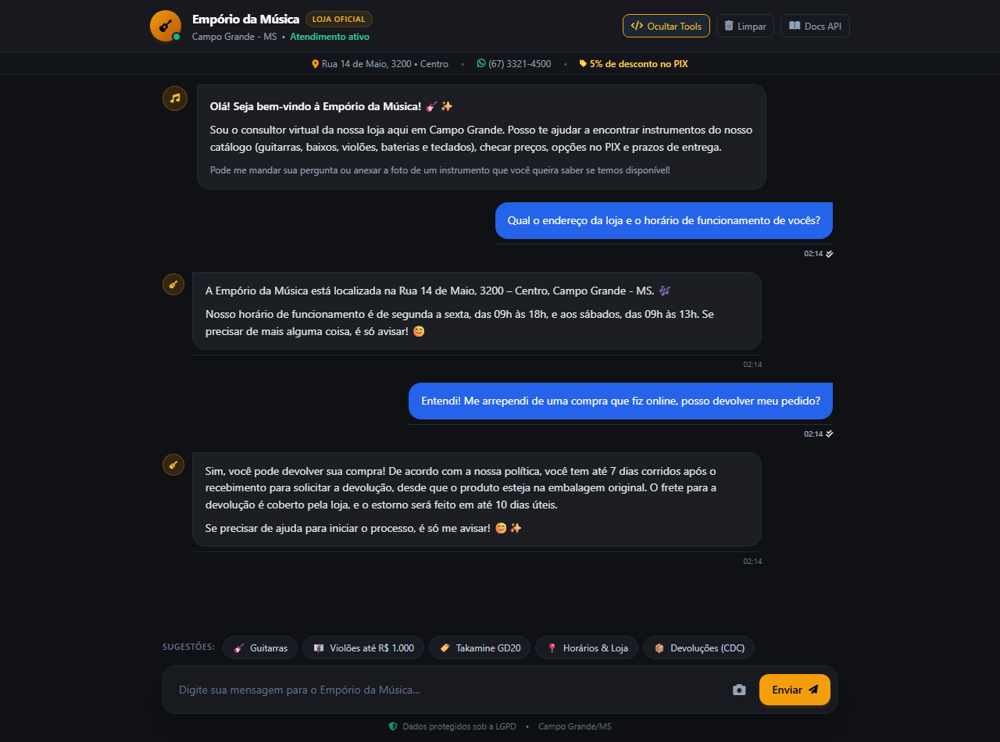
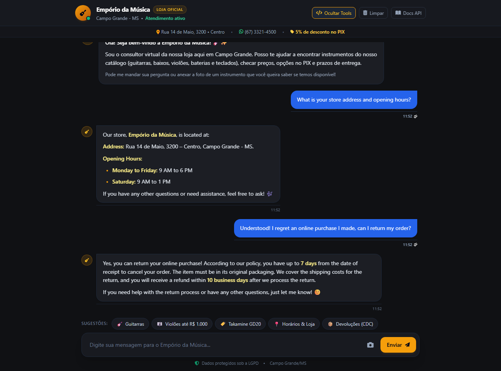

# 💬 Cenário 2: Informações da Loja, Horários e Política de Devolução (CDC) / Scenario 2: Store Information, Business Hours & Statutory Return Policy (CDC)

> **Bilingual Documentation Notice**:
> This evaluation scenario is presented bilingually. Below you will find the original Portuguese dialogue with its real store web chat screenshot, followed immediately by the full English transcript and technical walkthrough with its live English browser screenshot.

**Descrição (PT-BR):** Consulta de dados cadastrais, endereço e horários em Campo Grande/MS combinada com a aplicação das regras do Código de Defesa do Consumidor (direito de arrependimento em 7 dias).  
**Description (EN):** Store address and operating hours lookup in Campo Grande/MS combined with statutory Brazilian Consumer Defense Code rules (7-day remorse return).

---

## 🇧🇷 Diálogo Original & Captura de Tela (Português - Brasil)

### 👤 Usuário
> "Qual o endereço da loja e o horário de funcionamento de vocês?"

### 🤖 Assistente Virtual
A Empório da Música está localizada na **Rua 14 de Maio, 3200 – Centro, Campo Grande - MS**. 🎶

Nosso horário de funcionamento é:
• **Segunda a Sexta**: das 09h às 18h  
• **Sábados**: das 09h às 13h  

Se precisar de mais alguma coisa, é só avisar! 😊

---

### 👤 Usuário
> "Entendi! Me arrependi de uma compra que fiz online, posso devolver meu pedido?"

### 🤖 Assistente Virtual
Sim, você pode devolver sua compra! De acordo com a nossa política e o CDC, você tem até **7 dias corridos após o recebimento** para solicitar a devolução por arrependimento, desde que o produto esteja na embalagem original.

O frete de devolução é **100% coberto pela loja**, e o estorno será realizado em até **10 dias úteis** após a chegada e conferência do produto.

Se precisar de ajuda para iniciar o processo, é só me avisar! 😊✨

---

## 🇬🇧 English Transcript & Live Browser Screenshot

### 👤 Customer
> "What is your store address and opening hours?"

### 🤖 Virtual Assistant

Our store, Empório da Música, is located at:

Address: Rua 14 de Maio, 3200 – Centro, Campo Grande - MS.

Opening Hours:

Monday to Friday: 9 AM to 6 PM
Saturday: 9 AM to 1 PM

If you have any other questions or need assistance, feel free to ask! 🎶

---

### 👤 Customer
> "Understood! I regret an online purchase I made, can I return my order?"

### 🤖 Virtual Assistant

Yes, you can return your online purchase! According to our policy, you have up to 7 days from the date of receipt to cancel your order. The item must be in its original packaging. We cover the shipping costs for the return, and you will receive a refund within 10 business days after we process the return.

If you need help with the return process or have any other questions, just let me know! 😊

---

