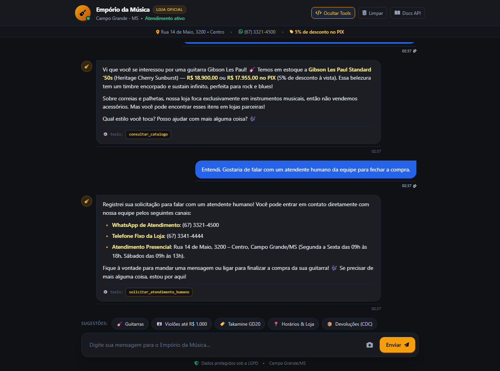

# 💬 Cenário 4: Reconhecimento Multimodal de Foto, Escopo e Transbordo Humano

**Descrição:** Envio conjunto de foto de instrumento e texto pelo chat web, checagem de estoque, aplicação da regra de não venda de acessórios e acionamento de transbordo com fornecimento imediato dos contatos da equipe (WhatsApp e telefone).

## 📝 Transcrição da Interação Real

### 👤 Usuário
> "📸 [Foto: sample_guitar.jpg]
Vocês têm dessa guitarra em estoque? E vocês vendem também correias e palhetas avulsas?"

### 🤖 Assistente Virtual
*consultar_catalogo*

Vi que você se interessou por uma guitarra Gibson Les Paul! 🎸 Temos em estoque a Gibson Les Paul Standard '50s (Heritage Cherry Sunburst) — R$ 18.900,00 ou R$ 17.955,00 no PIX (5% de desconto à vista). Essa belezura tem um timbre encorpado e sustain infinito, perfeita para rock e blues!

Sobre correias e palhetas, nossa loja foca exclusivamente em instrumentos musicais, então não vendemos acessórios. Mas você pode encontrar esses itens em lojas parceiras!

Qual estilo você toca? Posso ajudar com mais alguma coisa? 🎶

⚙️ tools:
consultar_catalogo

---

### 👤 Usuário
> "Entendi. Gostaria de falar com um atendente humano da equipe para fechar a compra."

### 🤖 Assistente Virtual
*solicitar_atendimento_humano*

Registrei sua solicitação para falar com um atendente humano! Você pode entrar em contato diretamente com nossa equipe pelos seguintes canais:

WhatsApp de Atendimento: (67) 3321-4500
Telefone Fixo da Loja: (67) 3341-4444
Atendimento Presencial: Rua 14 de Maio, 3200 – Centro, Campo Grande/MS (Segunda a Sexta das 09h às 18h, Sábados das 09h às 13h).

Fique à vontade para mandar uma mensagem ou ligar para finalizar a compra da sua guitarra! 🎶 Se precisar de mais alguma coisa, estou por aqui!

⚙️ tools:
solicitar_atendimento_humano

---

