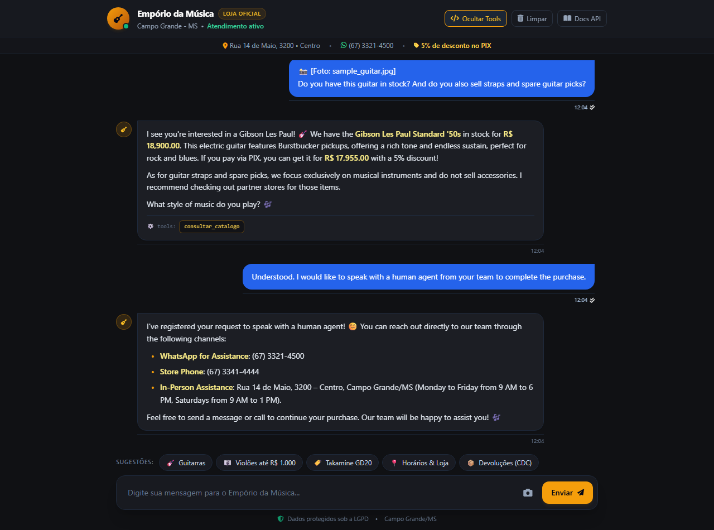

# 💬 Cenário 4: Reconhecimento Multimodal de Foto, Escopo e Transbordo Humano / Scenario 4: Multimodal Photo Recognition, Scope & Human Handoff

> **Bilingual Documentation Notice**:
> This evaluation scenario is presented bilingually. Below you will find the original Portuguese dialogue with its real store web chat screenshot, followed immediately by the full English transcript and technical walkthrough with its live English browser screenshot.

**Descrição (PT-BR):** Envio conjunto de foto de instrumento e texto pelo chat web, checagem de estoque, aplicação da regra de não venda de acessórios e acionamento de transbordo com fornecimento imediato dos contatos da equipe (WhatsApp e telefone).  
**Description (EN):** Multimodal image submission via web chat, catalog stock check, polite refusal of out-of-scope accessories, and human handoff with direct store contacts.

---

## 🇧🇷 Diálogo Original & Captura de Tela (Português - Brasil)

### 👤 Usuário
> 📸 [Foto: sample_guitar.jpg]  
> "Vocês têm dessa guitarra em estoque? E vocês vendem também correias e palhetas avulsas?"

### 🤖 Assistente Virtual
*consultar_catalogo*

Vi pela sua foto que você se interessou por uma **Gibson Les Paul**! 🎸 Temos em estoque a **Gibson Les Paul Standard '50s** (Heritage Cherry Sunburst) por **R$ 18.900,00** (ou **R$ 17.955,00 no PIX** com 5% de desconto à vista). Um clássico com timbre encorpado e sustain infinito!

Sobre correias e palhetas: nossa loja foca **exclusivamente em instrumentos musicais**, portanto não vendemos acessórios avulsos. Sugiro procurar lojas de acessórios parceiras.

Qual estilo você toca? Posso ajudar com mais alguma coisa? 🎶

⚙️ tools:
`consultar_catalogo`

---

### 👤 Usuário
> "Entendi. Gostaria de falar com um atendente humano da equipe para fechar a compra."

### 🤖 Assistente Virtual
*solicitar_atendimento_humano*

Registrei sua solicitação para falar com um atendente humano! Você pode entrar em contato diretamente com nossa equipe agora mesmo pelos seguintes canais:

• **WhatsApp de Atendimento:** (67) 3321-4500  
• **Telefone Fixo da Loja:** (67) 3341-4444  
• **Atendimento Presencial:** Rua 14 de Maio, 3200 – Centro, Campo Grande/MS (Segunda a Sexta das 09h às 18h, Sábados das 09h às 13h)  

Fique à vontade para mandar uma mensagem no WhatsApp ou ligar para dar continuidade à compra da sua guitarra com nossos consultores! 🎶

⚙️ tools:
`solicitar_atendimento_humano`

---

## 🇬🇧 English Transcript & Live Browser Screenshot

### 👤 Customer
> "📸 [Foto: sample_guitar.jpg]
Do you have this guitar in stock? And do you also sell straps and spare guitar picks?"

### 🤖 Virtual Assistant

⚙️ **Tools Called:** `consultar_catalogo`

I see you're interested in a Gibson Les Paul! 🎸 We have the Gibson Les Paul Standard '50s in stock for R$ 18,900.00. This electric guitar features Burstbucker pickups, offering a rich tone and endless sustain, perfect for rock and blues. If you pay via PIX, you can get it for R$ 17,955.00 with a 5% discount!

As for guitar straps and spare picks, we focus exclusively on musical instruments and do not sell accessories. I recommend checking out partner stores for those items.

What style of music do you play? 🎶

⚙️ tools:
consultar_catalogo

---

### 👤 Customer
> "Understood. I would like to speak with a human agent from your team to complete the purchase."

### 🤖 Virtual Assistant

I've registered your request to speak with a human agent! 😊 You can reach out directly to our team through the following channels:

WhatsApp for Assistance: (67) 3321-4500
Store Phone: (67) 3341-4444
In-Person Assistance: Rua 14 de Maio, 3200 – Centro, Campo Grande/MS (Monday to Friday from 9 AM to 6 PM, Saturdays from 9 AM to 1 PM).

Feel free to send a message or call to continue your purchase. Our team will be happy to assist you! 🎶

---

