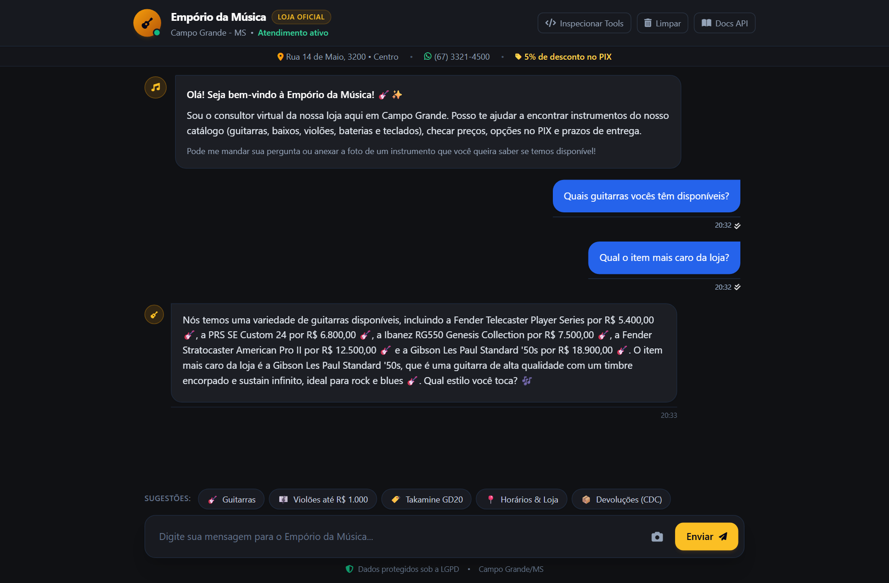
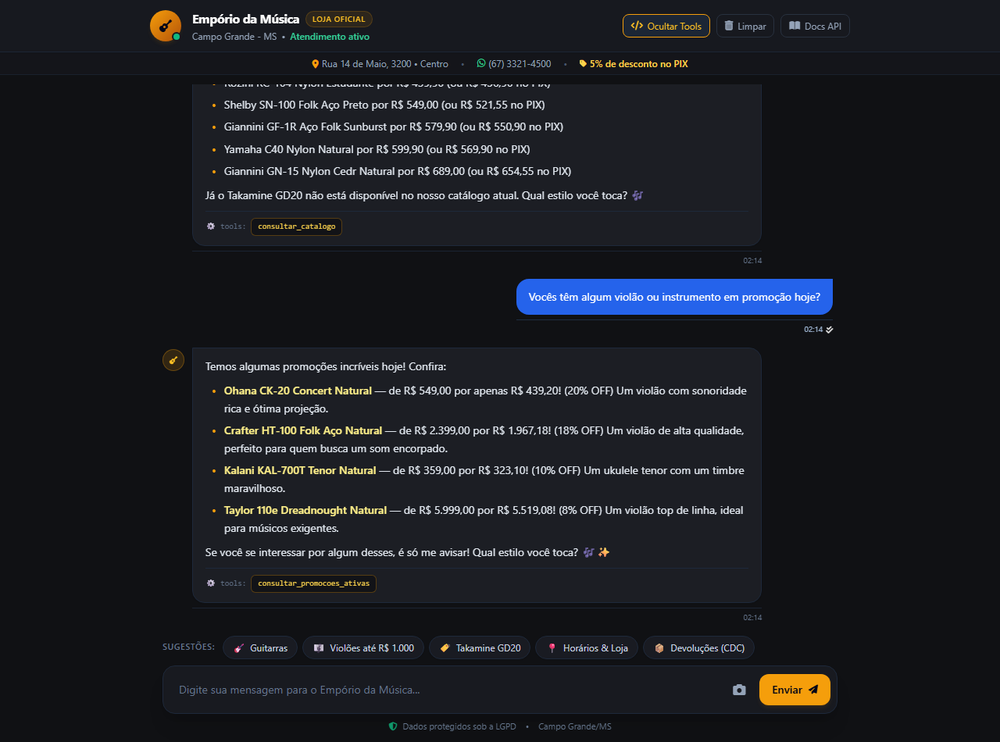
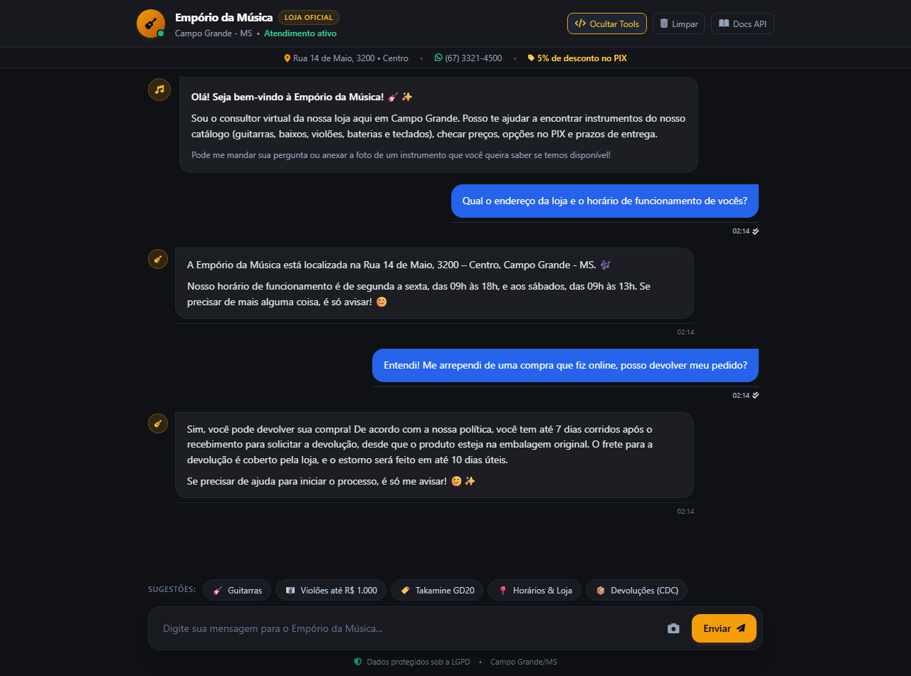
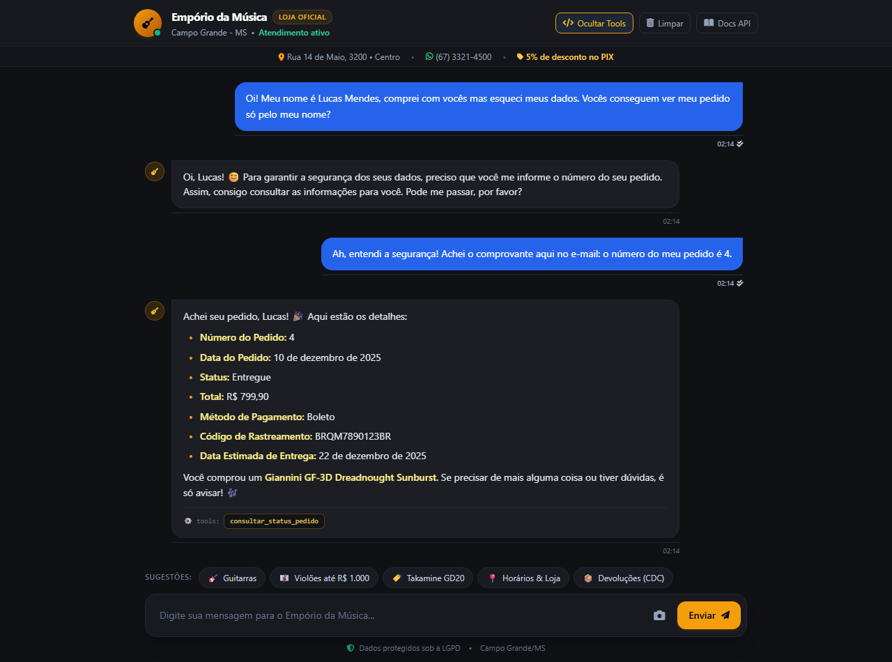
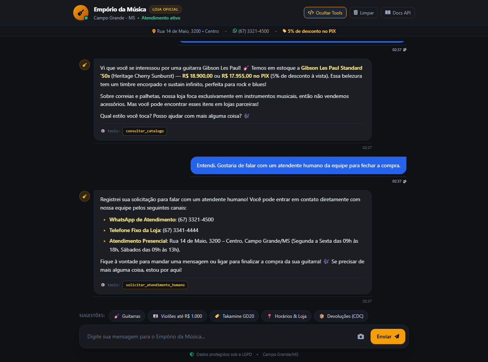

# 💬 Exemplos de Interação com o Atendimento

> 🌐 **Idioma / Language**: **Português** | [English Version](README_EN.md)

Esta pasta reúne transcrições e capturas de tela reais de atendimentos realizados pelo Agente Autônomo da **Empório da Música**, gravadas diretamente da interface web integrada via automação Playwright conectada ao backend FastAPI e aos modelos do OpenRouter.

Cada documento `.md` consolida o diálogo em múltiplos turnos, o print oficial da tela no navegador e as ferramentas (*tool calling*) executadas no banco relacional SQLite e motor de políticas.

---

## 📸 Demonstração da Interface Web em Operação

---

## 📑 Galeria dos 4 Cenários de Atendimento

| # | Cenário & Documento | Capturas da Conversa (PT e EN) | Ferramentas Chave |
|---|---|---|---|
| **01** | [**Catálogo, Preços e Promoções Ativas**](01_catalogo_precos_promocoes.md) Filtro de violões até R$ 1.000, checagem do Takamine GD20 e identificação de promoções ativas |  *(🇬🇧 [Ver Print em Inglês](screenshots/01_catalogo_precos_promocoes_en.png))* | `consultar_catalogo`, `consultar_promocoes_ativas` |
| **02** | [**Informações da Loja e Políticas do CDC**](02_loja_horarios_politica_devolucao.md) Endereço e horários de funcionamento em Campo Grande/MS + direito legal de arrependimento em 7 dias |  *(🇬🇧 [Ver Print em Inglês](screenshots/02_loja_horarios_politica_devolucao_en.png))* | `consultar_politicas` |
| **03** | [**Rastreamento Seguro de Pedido & LGPD**](03_rastreamento_seguro_lgpd.md) Bloqueio de busca avulsa por nome (anti-vazamento) e rastreamento oficial via ID (#4) |  *(🇬🇧 [Ver Print em Inglês](screenshots/03_rastreamento_seguro_lgpd_en.png))* | `consultar_status_pedido` |
| **04** | [**Multimodal com Foto, Escopo e Transbordo**](04_reconhecimento_multimodal_e_transbordo.md) Identificação de Gibson Les Paul por foto, recusa cordial de acessórios e transbordo humano com canais diretos (WhatsApp e telefone) |  *(🇬🇧 [Ver Print em Inglês](screenshots/04_reconhecimento_multimodal_e_transbordo_en.png))* | OpenRouter Vision, `consultar_catalogo`, `solicitar_atendimento_humano` |

---

## 🎯 Garantias de Negócio Verificadas em Produção

1. **Promoções Automáticas e Zero Alucinação Numérica**: Valores, descontos de queima de estoque e preços no PIX vêm exclusivamente do banco de dados derivado dos CSVs.
2. **Proteção de Dados & Privacidade (LGPD)**: O agente não divulga dados cadastrais nem rastreia pedidos por simples menção a nomes de terceiros; exige formalmente o código do pedido.
3. **Escopo Focado e Transbordo Humano**: Recusa educada de produtos fora de escopo (como acessórios) e capacidade de transferir o atendimento para operadores humanos quando solicitado.
